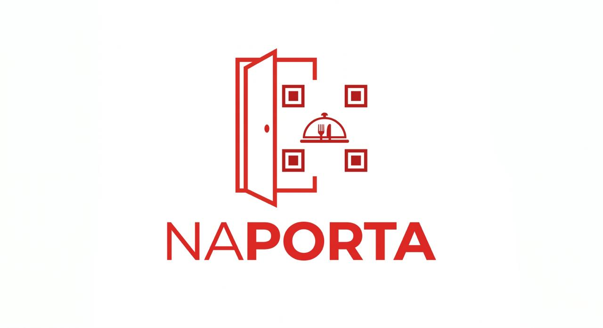

# NaPortaApp - V2

- Software mobile de delivery interno para gestão/controle de pedidos dos usuários do hotel, permitindos que os hóspedes realizem a solicitação de comidas, bebidas e outros serviços através de um QRCode que identifica o quarto, e respectivamente, o usuário solicitante.

> 🚧 **Status:** Em desenvolvimento

## Estrutura do Repositório

- **API**: Armazena o código backend da aplicação;
- **MOBILE**: Armazena a interface mobile do cliente.
- **WEB**: Armazena a interface web do cliente;

## Stack Ferramental

- **Backend:** Node.js, Fastify, PrismaORM v7, PostgreSQL, Redis, Docker, Zod.
- **Mobile:** Java com Kotlin (Android Studio), Retrofit, Android API +24.
- **Frontend:** React.js, React-Hook-Form, React-Router, Tanstack-Query, Shadcn, RadixUI, PhosphorIcons, Axios, Date-fns, Zod, Sonner, ReCharts, React-Helmet, Tailwindcss.
- **Tooling:** TypeScript, ESLint, Prettier.

## Documentação de Negócio

## Arquitetura

- API REST utilizando Nodejs
- Autenticação baseada em JWT
- Autenticação automática via Refresh Token (JWT)
- Controle de acesso baseado em papéis (RBAC)
- Persistência com PostgreSQL
- Cache e Rate Limiting com Redis
- Validação de entrada com Zod

### Requisitos Funcionais (RF)

- [ ] O usuário deve poder ler um QRCode que identifica-o, acessando a plataforma (login);
- [ ] O usuário deve poder realizar pedidos (deve ser encaminhado para o Gateway de pagamento);
- [ ] O usuário deve poder visualizar despesas agrupadas por data e valor;
- [ ] O usuário deve poder visualizar a quantidade de despesas por categoria;
- [ ] O usuário deve poder visualizar suas informações de perfil;
- [ ] O usuário deve poder visualizar o histórico de todas as suas despesas;
- [ ] O usuário deve poder visualizar a quantidade de refeições registradas;
- [ ] O usuário deve poder visualizar a quantidade de refeições registradas no dia;
- [ ] O usuário deve poder visualizar o valor gasto do mês;
- [ ] O usuário deve poder visualizar o valor gasto do dia;
- [ ] O usuário deve poder filtrar seu histórico de despesas por período e por categoria;
- [ ] O funcionário/administrador deve poder cadastrar refeições;
- [ ] O funcionário/administrador deve poder cadastrar categorias;
- [ ] O funcionário/administrador deve poder desabilitar qualquer usuário;
- [ ] O funcionário/administrador deve poder cadastrar um usuário (quarto, status, data_criação, start_checkout, end_checkout );
- [ ] O administrador deve poder gerenciar as permissões entre: "member", "employee", "admin";
- [ ] O administrador deve poder cadastrar refeições;
- [ ] O administrador deve poder trocar permissão do usuário;
- [ ] O administrador deve poder deletar refeições;
- [ ] O administrador deve poder deletar categorias;
- [ ] O administrador deve poder visualizar todos os usuários;
- [ ] O usuário deve poder interagir com chatbot com IA (leitura da base de dados);

### Requisitos Não-Funcionais (RNF)

- [ ] A senha do usuário precisa estar em formato hash;
- [ ] Os dados da aplicação precisam estar persistidos em um banco H2 Database;
- [ ] Todas as listas de dados precisam estar paginadas com 15 itens por página; 
- [ ] O banco de dados deve utilizar UUID v7 para performance e identificação;
- [ ] O usuário deve ser identificado por um JWT (JSON Web Token) entre as requisições;
- [ ] Todos os usuários devem ser identificados pela permissão de "membro", "funcionário" ou "admin";
- [ ] O Redis deve ser utilizado para cache e rate limiting;
- [ ] O sistema deve possuir tratamento centralizado de erros;
- [ ] O administrador não pode visualizar senhas dos usuários.
- [ ] Todas as rotas precisam estar documentadas utilizando o swagger;
- [ ] Os testes unitários devem ter cobertura de 70% (coverage);
- [ ] O sistema deve implementar refresh token para renovação de autenticação;
- [ ] A API deve registrar logs de erros e auditoria;

### Regras de Negócio (RN)

- [ ] O usuário cadastradado pelo func/admin não deve poder se cadastrar com e-mail duplicado;
- [ ] O administrador não deve poder cadastrar categorias com o mesmo título;
- [ ] O administrador não deve poder deletar uma categoria com gastos vinculados;
- [ ] O token de reset de senha deve expirar em 15 minutos e só pode ser usado uma vez;
- [ ] O usuário que solicitou renovação de senha não pode cadastrar a mesma senha novamente;
- [ ] Os usuários, por padrão, recebem o cargo (permissão) de "membro";
- [ ] O usuário não deve poder visualizar refeições de outros usuários;
- [ ] O administrador pode visualizar todos os usuários;
- [ ] Ao deletar uma conta, todas as despesas e categorias vinculadas devem ser deletadas em cascata.

## Fluxograma de Desenvolvimento

## Estrutura do Banco de Dados

### Entidades

- [ ] Users
- [ ] Rooms
- [ ] Guests
- [ ] MenuItems
- [ ] Orders
- [ ] OrderItems

### Relacionamentos

- Um usuário possui um quarto e possui várias refeições
- Uma categoria pode possuir várias refeições
- Uma refeição pertence a uma categoria

## Comandos para Iniciar o Projeto

### API

#### Desenvolvimento

#### Start Frontend
- `pnpm run dev` — iniciar projeto para abrir no navegador
- `pnpm run build` — iniciar o build do projeto
- `pnpm run lint` — iniciar o lint pra corrigir o código

#### Testes
- `pnpm test` — executa os testes uma vez
- `pnpm test:watch` — executa os testes em modo watch
- `pnpm test:coverage` — executa os testes com cobertura
- `pnpm test:ui` — abre a interface visual dos testes

#### Banco de Dados

#### Qualidade de Código
- `pnpm lint` — verifica problemas de lint
- `pnpm lint:fix` — corrige problemas de lint automaticamente
- `pnpm format` — formata o código com Prettier

## Comandos de Desenvolvimento
